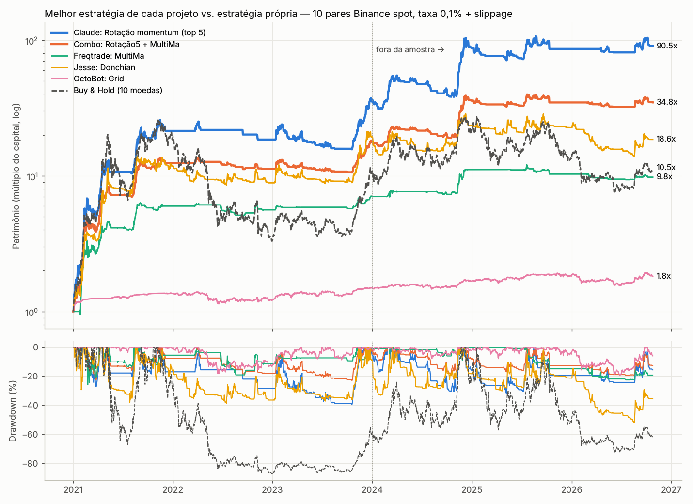

# Cripto: comparação de bots de trade open-source e uma estratégia própria

Este repositório compara, nas mesmas condições, as estratégias dos principais projetos open-source de trade de cripto no GitHub. Também testa se dá para combiná-las e se uma estratégia própria consegue superar todas elas.

> **Aviso.** Backtest não garante resultado futuro. Os números abaixo usam taxa de 0,1% por lado mais 0,02% de slippage e execução no candle seguinte ao sinal, sem look-ahead. Mesmo assim, ignoram impostos, liquidez extrema, falhas de exchange e o risco de a estratégia parar de funcionar. Nada aqui é recomendação de investimento.



## 1. Projetos escolhidos

| # | Projeto | Por que entrou | Como foi testado |
|---|---|---|---|
| 1 | **[freqtrade/freqtrade](https://github.com/freqtrade/freqtrade)** (~50k ⭐) | É o bot open-source mais usado | Instalado (v2026.9). As estratégias oficiais de [freqtrade-strategies](https://github.com/freqtrade/freqtrade-strategies) rodaram no **backtester do próprio freqtrade** |
| 2 | **[iterativv/NostalgiaForInfinity](https://github.com/iterativv/NostalgiaForInfinity)** | É a estratégia comunitária mais famosa do freqtrade | Rodou no freqtrade (X7). Como é muito pesada (80 mil linhas, ~9 GB de RAM por ano de dados 5m), foi rodada em janelas anuais de 2022 a 2026, encadeadas |
| 3 | **[jesse-ai/jesse](https://github.com/jesse-ai/jesse)** | É o framework de pesquisa e backtest mais citado | Instalado. As estratégias de [example-strategies](https://github.com/jesse-ai/example-strategies) rodaram no **motor do próprio Jesse** (`jesse.research.backtest`) sobre candles de 1m |
| 4 | **[hummingbot/hummingbot](https://github.com/hummingbot/hummingbot)** (~20k ⭐) | É referência em market making e scalping | Os controllers direcionais V2 (`bollinger_v1`, `macd_bb_v1`, `supertrend_v1`) foram portados com os parâmetros padrão: candles de 3m, triple barrier SL 3% / TP 2% / 45 min, cooldown e 2 executores por lado |
| 5 | **[Drakkar-Software/OctoBot](https://github.com/Drakkar-Software/OctoBot)** (~5k ⭐) | Oferece grid, DCA e "daily trading" prontos | Os perfis padrão (Grid, Trailing Grid, Simple DCA, Smart DCA e Daily Trading com os avaliadores RSI e Double MA) foram portados para o motor comum |

O market making puro do Hummingbot (PMM) e a arbitragem não foram simulados. Eles dependem de livro de ofertas e da fila de ordens, que candles não representam.

## 2. Dados

- Fonte: dados públicos completos da Binance em **data.binance.vision**, com klines spot de 1 minuto desde 2017. A API `api.binance.com` é bloqueada por região neste ambiente, então o freqtrade recebe os mercados por um wrapper offline (`freqtrade/ft.py`).
- São 10 pares USDT: BTC, ETH, BNB, SOL, XRP, ADA, DOGE, LTC, LINK e AVAX. Isso dá cerca de 43 milhões de candles de 1m, reamostrados para 3m, 5m, 15m, 1h, 4h e 1d. Para reproduzir, rode `scripts/download_binance.py`.
- Para checar o **viés de sobrevivência**, há também um universo de 70 moedas em 1h, incluindo as que colapsaram ou foram deslistadas (LUNA, FTT, SRM, WAVES, EOS etc.), com seleção point-in-time pelas top-N em volume (`scripts/download_universe.py`).
- Período comum: **2021-01-01 → 2026-10-25**. A janela **fora da amostra (OOS)** vai de 2024-01 a 2026-10.

## 3. Resultado: qual rende mais

O ranking completo está em [`results/ranking_geral.md`](results/ranking_geral.md). A tabela abaixo mostra a melhor estratégia de cada projeto. Cada uma começa com o mesmo capital, de 2021-01 a 2026-10:

| Projeto | Melhor estratégia | Retorno total | CAGR | Max DD | Sharpe | CAGR OOS 24-26 | DD OOS |
|---|---|---|---|---|---|---|---|
| Benchmark | Buy & Hold dos 10 pares | +954% | 50% | **-87%** | 0,90 | -1% | -72% |
| Jesse | Donchian (4h) | +1.755% | 65% | -52% | 1,10 | -1% | -52% |
| Freqtrade | **MultiMa** (4h) | +877% | 48% | **-26%** | **1,39** | 12% | -23% |
| OctoBot | Grid | +81% | 11% | -19% | 0,80 | 7% | -19% |
| NostalgiaForInfinity | X7 (5m) — *só 2022-01 → 2026-10* | +100% | 15,5% | **-5%** | **1,85** | 17% | -5% |
| Hummingbot | (todos perdem: scalping de 3m não sobrevive à taxa de 0,1%) | -91% a -100% | | | | | |
| **Própria** | **Rotação de momentum (top 5)** | **+8.952%** | **117%** | -39% | **1,82** | **40%** | -32% |
| **Própria** | Rotação de momentum (top 3, agressiva) | +19.042% | 147% | -56% | 1,79 | 69% | -33% |
| **Combo** | **Rotação5 + MultiMa (50/50)** | +3.379% | 84% | **-23%** | **2,14** | 27% | **-19%** |

O que os números mostram:

1. **Entre os projetos prontos, o MultiMa do freqtrade é o mais sólido.** É uma tendência com médias TEMA e take-profit escalonado. Teve o menor drawdown entre as estratégias que ganham bem e é o único que bate o buy & hold em risco ajustado nas duas janelas. O Donchian do Jesse ganhou mais em 2021, mas ficou no zero de 2024 a 2026.
2. **39 das 61 estratégias externas testadas no período completo (64%) perdem dinheiro** depois das taxas, e só 2 batem o buy & hold em CAGR. As piores são os scalpers de 5m a 15m e as de reversão à média. Os 4 scalpers de 1m que couberam na memória (testados só em 2025-2026) também perderam, de -2% a -99,8%.
3. **Os controllers do Hummingbot e o DailyTrading do OctoBot, com parâmetros padrão, destroem capital.** Fazem dezenas de milhares de operações com alvo de 2% e pagam 0,24% de custo por ida e volta. O Hummingbot só faz sentido como market maker, com taxa maker ou rebate.
4. **A NostalgiaForInfinity X7 é a melhor estratégia externa em risco.** É um comprador de quedas extremas com recompras (DCA) e fica em caixa ~75% do tempo. De 2022 a 2026 lucrou em **todos os anos**: +18% em 2022, quando o buy & hold caiu 83%, e +27% em 2025. O drawdown máximo foi de só -5%. O retorno absoluto é modesto: 15,5% ao ano, contra 35% da rotação na mesma janela. Ressalva: as janelas anuais forçam o fechamento das posições na virada do ano.
5. **Grid (OctoBot)** dá retorno baixo e estável: 11% ao ano com DD de -19%. Ele fica 100% em USDT quando o preço sai do range para cima e "segura o saco" quando o preço cai abaixo do range.

## 4. As estratégias se complementam?

Sim, mas só as que capturam fenômenos diferentes. Os detalhes estão em `research/r3_combine.py`, com os resultados em `results/r3_*.csv`.

- A correlação diária entre a **Rotação** (própria) e o **MultiMa** é de apenas **0,12**. Já os seguidores de tendência "clássicos" entre si (Donchian, MACD_EMA, SMACrossover, SimpleBollinger) ficam entre 0,5 e 0,7: na prática são a mesma aposta.
- Grid e DCA têm correlação de 0,7 a 0,97 com o buy & hold, então não diversificam nada em queda.
- **A melhor complementação foi Rotação5 + MultiMa, 50/50 com rebalanceamento semanal.** No período inteiro, o Sharpe sobe para **2,14**, o maior de todos, e o Calmar para 3,7. O drawdown fora da amostra cai de -32% para **-19%**, mantendo ~27% ao ano. Somando o Grid do OctoBot (1/3 cada), o DD OOS fica em -18%.
- **A NostalgiaForInfinity é o melhor complemento.** A correlação diária dela com todas as outras fica entre -0,04 e 0,05, porque ela compra quedas enquanto as demais seguem tendência. Resultado de 2022-01 a 2026-10 (`research/r7_nfi.py`, `results/r7_nfi.csv`):

  | Carteira (pesos iguais, rebal. semanal) | CAGR | Max DD | Sharpe | 2022 | 2025 |
  |---|---|---|---|---|---|
  | Rotação5 sozinha | 34,9% | -37,8% | 1,00 | -13,7% | -1,3% |
  | NFI X7 sozinha | 15,5% | -5,1% | 1,85 | +17,7% | +27,2% |
  | **Rotação5 + NFI** | **27,5%** | **-17,4%** | 1,39 | +1,3% | +14,4% |
  | Rotação5 + MultiMa + NFI | 22,0% | -12,5% | 1,44 | -0,9% | +7,1% |
  | Rotação5 + MultiMa | 23,8% | -23,0% | 1,10 | -9,5% | -3,0% |
  | Buy & Hold | -11,9% | -83,0% | 0,20 | -82,8% | -36,9% |

  A rotação ganha nas altas (2023-2024) e a NFI segura as quedas e os mercados laterais (2022, 2025). Juntas, elas cortam o drawdown pela metade e mantêm a maior parte do retorno.
- Adicionar mais membros pelo histórico piora o resultado. Com o AwesomeMacd como 3º membro, o Sharpe da seleção sobe de 2,8 para 2,9, mas o CAGR OOS cai de 27% para 11%.
- **Cuidado com combinar só pelo histórico.** Escolhendo de forma gulosa apenas entre as estratégias externas, pelo Sharpe de 2021-2023, saiu MultiMa + AwesomeMacd + Donchian (Sharpe 2,4 no período de seleção). Fora da amostra, esse combo deu **-1% ao ano com DD de -52%**. Combinar estratégias que só pareceram boas no passado é overfitting disfarçado.

## 5. Uma estratégia melhor que todas

**Rotação de momentum entre moedas com filtros de regime** (`engine/mine.py: s_rotation`, `research/r4_final.py`):

1. Todo dia (fechamento UTC), calcula para cada moeda o **momentum = retorno de 14 dias ÷ volatilidade de 14 dias**.
2. Compra as **5 melhores** em pesos iguais (20% cada), desde que o momentum seja > 0 e o preço esteja acima da própria SMA de 50 dias.
3. Só fica exposta se o **BTC estiver acima da SMA de 100 dias**. Fora disso, fica 100% em USDT. Esse filtro é o que evitou o -82% de 2022.
4. Executa na abertura seguinte, com banda de rebalanceamento de 10% para reduzir giro. São ~52 voltas de carteira por ano.

Por que ela funciona: momentum cross-sectional e tendência são os efeitos mais documentados em cripto. O filtro de regime corta a maior parte das quedas longas, e a seleção relativa captura as "altseasons" (SOL em 2021, DOGE e BNB, AVAX etc.).

### Como evitei me enganar

- Os parâmetros foram **escolhidos só com 2018-2023**, numa varredura de 432 combinações (`research/r1_rotation.py`). A escolha foi a de maior Sharpe no desenvolvimento. O período **2024-2026 ficou intocado** e é reportado como está. O "platô" é largo: as medianas de Sharpe no desenvolvimento variam de 1,5 a 1,9 em todos os parâmetros, então não é um pico isolado.
- **Viés de sobrevivência:** num universo de 70 moedas com LUNA, FTT etc., escolhendo as top 20/30 por volume na época, o resultado se mantém. O CAGR de 2021-2026 fica em 152-155% e o Sharpe em 1,7. O drawdown, porém, fica pior: entre -50% e -55%.
- **Custos:** com o triplo de taxa (0,3% por lado), ainda dá 98% ao ano. Com **1 dia de atraso** na execução, dá 108% ao ano.
- **Stops intradiários (ATR em 4h)** foram testados e **pioraram** o resultado. Execução em 4h em vez de diária também piorou.

### Onde ela é fraca

- É a de **maior retorno** em qualquer janela longa, mas **não é a melhor em todo regime**. Em 2025-2026, com o mercado em queda (buy & hold -52%), ela ficou praticamente parada: +3,5%, com DD de -24%. No mesmo período, a NostalgiaForInfinity fez +28% (`results/janela_2025_2026.csv`).
- Por isso, a recomendação final é a **combinação Rotação5 + NostalgiaForInfinity**. A rotação pega as altas e a NFI ganha nas quedas, sem correlação entre as duas.

### "Estratégia avançada com candles": modelo de ML

O `research/r2_ml_candles.py` treina um **LightGBM cross-sectional com 129 features**:

- anatomia dos candles: corpo, pavios e CLV;
- 16 padrões de candlestick do TA-Lib (engolfo, martelo, estrelas etc.) e Heikin-Ashi;
- estrutura intradiária em 4h, volume, RSI, distância de médias e contexto do BTC;
- ranks cross-sectionais.

O treino é walk-forward trimestral com embargo, no universo de 30 moedas sem viés de sobrevivência.

- O modelo **tem poder preditivo real**: IC de Spearman entre 0,10 e 0,14 em todos os anos de 2020 a 2026.
- Mesmo assim, **como carteira perde para a rotação simples**: 72-76% ao ano contra 147-155% no mesmo universo.
- **As features de padrão de candle praticamente não aparecem entre as importantes.** As 20 principais são todas de tendência, momentum e volatilidade (`dma200`, `ret90`, `dhigh60`, `atrp`...). O modelo "redescobre" o momentum com mais ruído.

Conclusão honesta: padrões clássicos de candle não trouxeram vantagem mensurável em cripto diária. A regra simples e robusta venceu o modelo complexo.

## 6. Como reproduzir

```bash
python3 -m venv ~/ftenv && ~/ftenv/bin/pip install freqtrade numba lightgbm tabulate
python3 -m venv ~/jenv  && ~/jenv/bin/pip install jesse            # (ambiente separado: conflito de numpy)

~/ftenv/bin/python scripts/download_binance.py BTCUSDT ETHUSDT BNBUSDT SOLUSDT XRPUSDT ADAUSDT DOGEUSDT LTCUSDT LINKUSDT AVAXUSDT
~/ftenv/bin/python scripts/to_freqtrade.py   BTCUSDT ETHUSDT ...        # feather p/ freqtrade
~/ftenv/bin/python scripts/download_universe.py                        # universo de 70 moedas (1h)

freqtrade/run_all.sh                                   # freqtrade (1 processo por vez se tiver < 16 GB de RAM)
~/jenv/bin/python jesse_bt/run_jesse.py                # Jesse
~/ftenv/bin/python -m engine.run_ports                 # Hummingbot / OctoBot + buy & hold
~/ftenv/bin/python -m engine.parse_freqtrade && ~/ftenv/bin/python -m engine.parse_jesse

~/ftenv/bin/python -m research.r1_rotation 10          # varredura da rotação (DEV/OOS)
~/ftenv/bin/python -m research.r2_ml_candles 30        # modelo de ML com candles
~/ftenv/bin/python -m research.r3_combine              # complementaridade e combos
~/ftenv/bin/python -m research.r4_final                # estratégia final + robustez
~/ftenv/bin/python -m research.r7_nfi                  # NostalgiaForInfinity (janelas anuais) + combinações
~/ftenv/bin/python -m research.r6_table && ~/ftenv/bin/python -m research.r5_charts

~/ftenv/bin/python -m scripts.sinal_rotacao 5          # carteira-alvo de hoje
```

## 7. Estrutura

```
engine/core.py        motor comum (numba): exposição-alvo, triple barrier, grid, carteira multiativo, métricas
engine/ports.py       ports Hummingbot (3 controllers) e OctoBot (5 perfis)
engine/mine.py        blocos de sinal e estratégias próprias (rotação, TSMOM, turtle, overlay de stop)
freqtrade/            config, wrapper offline de mercados, estratégias oficiais + NFI
jesse_bt/             runner do Jesse + estratégias de exemplo (patch mínimo de compatibilidade no KDJ)
research/             r1 varredura · r2 ML com candles · r3 combinações · r4 final/robustez · r5 gráficos · r6 tabela · r7 NFI
results/              CSVs, curvas diárias (parquet) e gráfico
```

## 8. Limitações conhecidas

- Os 10 pares são as moedas grandes de hoje, o que favorece qualquer estratégia comprada (inclusive o buy & hold). O teste no universo de 70 moedas mitiga isso.
- Hummingbot e OctoBot foram **portados**, não rodados nos motores originais (os backtesters deles exigem infraestrutura de exchange e banco). A lógica e os parâmetros padrão foram copiados dos repositórios. Os avaliadores do OctoBot foram simplificados: a parte "chances to be max" do DoubleMA ficou de fora.
- A NostalgiaForInfinity só foi testada de 2022 em diante, em janelas anuais: 10 pares × 6 anos de 5m não cabem em 15 GB de RAM.
- No Jesse, o `TurtleRules` estoura a margem mesmo com 3x, pelo sizing piramidal, e o `IFR2` não gera sinais nesses pares. No freqtrade, `FixedRiskRewardLoss` é incompatível com o pandas atual e as estratégias short (`AlmgrenChriss`, `TWAP`) não rodam em spot. As estratégias de 1m rodaram só de 2025 a 2026, por limite de memória.
- A rotação concentra em poucas moedas: espere quedas de 30 a 55% e longos períodos parados em USDT (ela não opera em boa parte de 2022).

## 9. Fase 2: tentativas de melhorar (meta pedida: 20% ao mês)

Foram testadas (scripts `research/r8_new.py`, `r9_futures.py`, `r10_final2.py`; dados de 68 perpétuos USDT-M + funding real):

| Ideia | Resultado (2021-2026) | Veredito |
|---|---|---|
| Volatility Breakout (Larry Williams), 10 e 20 moedas | ~1%/mês, piora fora da amostra | ❌ |
| Compra de capitulação intradiária (1h) simples | perde 2-9%/mês | ❌ (a NFI só funciona pelos filtros dela) |
| Funding carry (spot comprado + perp vendido) | ~10%/ano até 2023, ≈0% em 2024-26 | ❌ morreu |
| Rotação vendendo a descoberto no mercado de baixa | DD -48% a -69% (short squeezes) | ❌ |
| Rotação market-neutral (long top / short piores) | 3-4%/mês, DD ~-30% | ➖ |
| **Rotação top 3 em perp + short parcial das piores** | **67%/ano** (2022-26), DD -35% | ✅ melhora |
| **Essa rotação + NFI (50/50)** | **43%/ano, DD -18%** | ✅ melhor equilíbrio |
| Alavancagem 2x / 3x da combinação | 81% / 118% ao ano, DD -36% / -52% | ⚠️ risco alto |

**20% ao mês não é alcançável de forma sustentável.** Na rotação, alavancar acima de ~2-3x *reduz* o retorno (o arrasto de volatilidade come o ganho) e leva à liquidação em 8x. A rotação sozinha tem meses de +80% a +100%, mas a **mediana mensal é ~0-2%**: o retorno vem de poucos meses explosivos de alta, entre longos períodos parados.

Distribuição mensal 2022-01 → 2026-10 (58 meses):

| Carteira | CAGR | Média/mês | Mediana/mês | Meses ≥ 20% | Meses negativos | Pior mês | Max DD |
|---|---|---|---|---|---|---|---|
| Rotação5 spot + NFI (fase 1) | 27% | 2,0% | 0,1% | 2 | 27 | -7% | -17% |
| **Rotação LS perp + NFI** | **43%** | **3,0%** | 1,7% | 2 | 20 | -6% | **-18%** |
| Rotação LS perp + NFI, 2x | 81% | 5,1% | 2,7% | 8 | 21 | -13% | -36% |
| Rotação LS perp + NFI, 3x | 118% | 6,7% | 3,7% | 12 | 22 | -19% | -52% |

Ressalva: a variante "top 3 + short parcial, 10 moedas" foi escolhida entre 24 variantes olhando também 2024-2026. A melhor pelo período de desenvolvimento ("both", 30 moedas, top 5) deu 41%/ano fora da amostra, então o ganho não depende dessa escolha, mas o número exato tem algum otimismo.

## 10. Fase 3: busca em larga escala e correção de viés (meta pedida: 10% ao mês)

### O que mudou: universo sem viés de sobrevivência
Nas fases 1-2, a rotação foi testada nas 10 moedas grandes de **hoje**, ou numa lista de 70 escolhida por mim. As duas carregam viés: sabemos hoje quais sobreviveram. Na fase 3, baixei **todos** os pares que já existiram na Binance:
- 900 perpétuos USDT-M com funding real, dos quais 670 cripto, depois de excluir as ações, ETFs e commodities lançadas em 2026;
- 754 pares spot USDT, dos quais 650 moedas, depois de excluir stables, fiat, wrapped e tokens alavancados.

A cada dia, a elegibilidade é point-in-time: entram as top-N por volume daquele momento.

**Correção importante:** com isso, os números das fases 1-2 se mostram otimistas. Na fase 2, a "rotação top 3 + short" dava 67%/ano. No universo completo, sem escolher as moedas a dedo, fica em 30-35%/ano em 2022-26, com quedas bem maiores.

### Busca de variações da rotação (`research/r11_variants.py`, `r14_analyze.py`)
Foram 9.000 variações sorteadas num espaço de 15 dimensões:
- horizonte e tipo do sinal (risco-ajustado, bruto, residual ao BTC, tendência suave, ensembles);
- quantas moedas comprar e tamanho do universo;
- 9 filtros de regime e filtro de média por moeda;
- frequência de rebalanceamento e histerese;
- short das piores e pesos pelo inverso da volatilidade;
- alvo de volatilidade, idade mínima, teto de volatilidade e stop intradiário.

Escolha só com DEV (2020-07 → 2023-12); OOS = 2024-01 → 2026-10.

| | Perpétuos (670 moedas) | Spot (650 moedas) |
|---|---|---|
| Correlação Sharpe DEV × OOS | 0,32 | 0,36 |
| Top 10% do DEV: CAGR mediano DEV → OOS | 80% → **-2%** | 139% → **19%** |
| Seletor walk-forward (melhor do último ano) | destrutivo (-8% a -84%/ano) | — |

Isso confirma overfitting forte. O que funciona tanto no DEV quanto no OOS:
- só as **5-10 moedas mais líquidas**;
- **regime BTC > SMA100**;
- **excluir moedas com vol > 100-150%/ano** (evita memecoins pumpadas, como o RAVE com -87% num dia);
- pesos pelo inverso da vol;
- **sem stop intradiário** (o stop piora em todas as versões).

**Rotação v2**: ensemble das 20 melhores (pelo DEV) dessa subfamília no universo spot completo. Dá **29%/ano em 2024-26**, Sharpe 0,93, DD -33%. Com 1, 5, 10 ou 40 membros o resultado é o mesmo (28-31%), então é robusto.

### Outras ideias testadas
| Ideia | Resultado | Veredito |
|---|---|---|
| Regime por ML (LightGBM prevendo BTC 14d) | AUC 0,46 (pior que acaso) | ❌ |
| Sazonalidade por hora/dia (BTC/ETH 1h) | não se repete fora da amostra | ❌ |
| Short de novas listagens (574 listagens) | squeezes de +100-500%; DD -58% a -98% | ❌ |
| Funding como fator (long funding baixo / short alto) | Sharpe ~2 em 2020-23, **quebra** em 2024-26 | ❌ |
| Reversão de curto prazo (1-3 dias) | perde sempre | ❌ |
| Seguir pumps extremos em 1m | positivo bruto, mas some com slippage realista | ❌ |
| **Comprar crash extremo em 1m** (queda z>8 em 60 min, segurar 4h) | +16%/ano, DD -9%, robusto a 4x o custo; enfraqueceu de +21% (2018-23) para +8% (2024-26) | ➖ pequeno |
| **NFI X7 escalada** (config recomendado, 25 pares point-in-time por janela de 4 meses) | 12-14%/ano, **DD -5%**, positiva em todas as 15 janelas | ✅ |

### Carteira final honesta (`research/r18_final.py`)
| Carteira (2024-26 fora da amostra) | CAGR | Média/mês | Max DD | Sharpe |
|---|---|---|---|---|
| Rotação v2 | 29% | 2,1% | -33% | 0,9 |
| NFI25 | 14% | 1,1% | -3% | 2,2 |
| **Rotação v2 + NFI25 (50/50)** | **23%** | **1,7%** | **-15%** | 1,3 |
| idem, alavancagem dinâmica (alvo de vol 30%, máx. 3x) | 35% | 2,5% | -25% | 1,2 |
| idem, 3x fixo | 53% | 3,6% | -45% | 1,1 |

**Conclusão:** 10% ao mês (~214%/ano) **não foi alcançável de forma robusta** em nenhuma das ~10.000 configurações testadas sem viés de sobrevivência. Os resultados de 100-300%/ano aparecem só no período em que foram escolhidos (com 2021 dentro) e não se repetem depois. O teto realista encontrado é 2-3,5% ao mês, com quedas de 25-45%.

## 11. Fase 4: análise técnica "profissional", sem alavancagem

**18 padrões programados com regras objetivas** (`research/ta/patterns.py`). Topos e fundos só contam depois de confirmados, como um trader os veria em tempo real:
- Smart Money Concepts: BOS, CHoCH, order block, FVG e varredura de liquidez;
- Wyckoff: spring;
- padrões clássicos: fundo duplo, triângulo ascendente, bandeira, VCP de Minervini;
- squeeze TTM, Donchian com volume, Ichimoku completo;
- divergência de RSI, engolfo em suporte, pullback na EMA20, Supertrend, Heikin-Ashi;
- confluência varredura + CHoCH.

**Universo:** 329 moedas que estiveram no top-30 por volume em algum momento (sem viés de sobrevivência), em 4h e 1d. Custo de 0,12% por lado.

### Estudo de evento (`r19_ta_events.py`, `r19b_report.py`)
Cerca de 150 mil sinais. Cada sinal vira uma operação com gestão padronizada e é comparado com entradas aleatórias da mesma semana.
- **Em altcoins, rompimentos perdem para entrada aleatória** (de -0,6% a -1,9% por operação, consistente nos dois períodos): Donchian, BOS, triângulo, Ichimoku, FVG, order block.
- **Em altcoins, padrões de reversão após "caça de stops" têm vantagem real, mas pequena.** Spring/varredura no 4h dá +0,4% (DEV) e +0,9% (OOS) contra o aleatório, com 7/7 e 3/3 anos positivos. No diário dá +2,1% e +3,3%. Divergência de RSI dá +0,9% nos dois períodos.
- **Em BTC/ETH é o contrário: rompimentos funcionam.** VCP dá +3,4%/+1,7% por operação contra o aleatório, squeeze +0,8%/+2,4% e Donchian +1,3%/+0,8%.

### Carteiras reais (`r21_ta_portfolio.py`, `r22_majors_breakout.py`, `r23_ta_final.py`)
- Carteiras de reversão em altcoins (5-10 posições): a vantagem não cobre custo e mercado em queda; **OOS negativo**.
- **Rompimento 4h em BTC+ETH** (VCP + Donchian55 c/ volume + squeeze TTM, stop técnico 1-4 ATR + stop móvel 4 ATR): DEV +58%/ano (DD -18%) e **OOS +25%/ano, DD -27%**. Comprar e segurar BTC/ETH no mesmo OOS deu +15% com DD -60%. A mediana de todas as variações no OOS fica em 10-14%. Estendido às top-3/top-5, o resultado piora (9%/4%), o que confirma o efeito "só grandes".

### Carteira técnica final, sem alavancagem (2024-26, fora da amostra)
| Carteira | CAGR | Média/mês | Max DD | Pior mês | Sharpe |
|---|---|---|---|---|---|
| Rompimento BTC/ETH (4h) | 25% | 1,9% | -27% | -7% | 0,9 |
| Rotação v2 (força relativa + médias) | 29% | 2,1% | -33% | -14% | 0,9 |
| NFI (compra de quedas multi-indicador) | 14% | 1,1% | -3% | -2% | 2,2 |
| **Rompimento + Rotação (50/50)** | **30%** | **2,2%** | -23% | -8% | 1,2 |
| **Os 3 (1/3 cada)** | **25%** | **1,9%** | **-14%** | **-5%** | **1,5** |

Correlação diária entre os três sistemas: de -0,08 a 0,04 (praticamente independentes).
